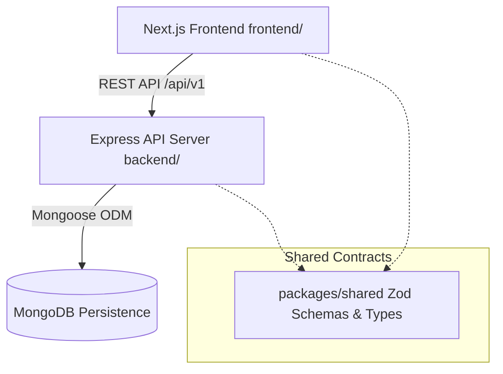

# Doctor Tracker

## 1. Elevator Pitch
Doctor Tracker is a secure, enterprise-grade administrative web application designed for healthcare facilities to seamlessly manage medical professionals, patient records, doctor-patient relationships, and real-time operational analytics. By providing robust role-based access control, server-side pagination, advanced filtering, and MongoDB aggregation pipelines, Doctor Tracker empowers healthcare administrators to maintain precise medical oversight with uncompromising privacy, security, and performance.

---

## 2. Features
- **Secure Authentication**: Bcrypt password hashing, HttpOnly session cookies, rate-limiting, and protected API middleware.
- **Administrative Dashboard**: Live summary metrics (total doctors, patients, patient-to-doctor ratios) and interactive data visualizations powered by Recharts (condition distribution, patient load per doctor).
- **Doctor Management**: Complete CRUD operations, advanced search across multiple fields, filtering by specialization and hospital, and server-side pagination.
- **Patient Management**: Global patient directory, patient assignment to specific doctors, editing, condition filtering, and confirmation-guarded deletion.
- **Doctor-to-Patient Relationships**: Scoped patient management view per doctor ensuring clear operational boundaries and relational integrity.
- **Responsive UI/UX**: Clean, healthcare-inspired design tailored for desktop, tablet, and mobile viewports with loading skeletons and inline validation.

---

## 3. Technology Stack
- **Frontend**: Next.js 14 (App Router), React 18, TypeScript strict mode, Tailwind CSS, TanStack React Query, React Hook Form, Zod, Recharts, Lucide Icons.
- **Backend**: Node.js, Express, TypeScript, RESTful API, Zod request validation, Express-Session, Helmet, CORS.
- **Database**: MongoDB & Mongoose for schema validation, indexing, and aggregation pipelines.
- **Testing**: Vitest & Supertest for API integration tests.

---

## 4. System Architecture
Doctor Tracker is structured as a robust monorepo featuring a decoupled frontend, Express REST API, and shared schema contracts.



---

## 5. Prerequisites
- **Node.js**: v18.x or v20.x LTS recommended
- **npm**: v9.x or higher
- **MongoDB**: Local MongoDB instance (v6+) or MongoDB Atlas connection URI

---

## 6. Local Setup Guide

1. **Clone or Open Repository**:
   ```bash
   cd doctor-tracker
   ```

2. **Install Dependencies**:
   ```bash
   npm install
   ```

3. **Configure Environment Variables**:
   Copy `.env.example` to `.env` in the root and configure your values:
   ```bash
   cp .env.example .env
   ```

4. **Build Shared Package**:
   ```bash
   npm run build:shared
   ```

5. **Run Database and API Server**:
   ```bash
   npm run dev:backend
   ```
   *(Note: The server automatically bootstraps an initial administrator if none exists, using `SEED_ADMIN_EMAIL` and `SEED_ADMIN_PASSWORD` from your `.env`).*

6. **Run Frontend Application**:
   In a separate terminal:
   ```bash
   npm run dev:frontend
   ```
   Open `http://localhost:3000` in your browser.

7. **Run Tests**:
   ```bash
   npm --prefix backend run test
   ```

8. **Create Production Builds**:
   ```bash
   npm run build
   ```

---

## 7. Environment Variables
- `NODE_ENV`: Environment mode (`development`, `production`, `test`).
- `MONGODB_URI`: MongoDB connection string.
- `PORT`: Port for Express API server (default: `5000`).
- `FRONTEND_URL`: Allowed CORS origin for frontend (default: `http://localhost:3000`).
- `SESSION_SECRET`: Cryptographic secret for signing session cookies (REQUIRED in production).
- `SEED_ADMIN_NAME`: Name of initial bootstrap administrator.
- `SEED_ADMIN_EMAIL`: Email of initial bootstrap administrator.
- `SEED_ADMIN_PASSWORD`: Password of initial bootstrap administrator.
- `NEXT_PUBLIC_API_URL`: Base URL for frontend API client.

---

## 8. API Documentation
All endpoints are versioned under `/api/v1`.

### Authentication
- `POST /api/v1/auth/login` — Admin login (sets secure session cookie).
- `POST /api/v1/auth/logout` — Destroy session.
- `GET /api/v1/auth/me` — Get current authenticated admin.

### Doctors
- `GET /api/v1/doctors` — List doctors (supports `page`, `limit`, `search`, `specialization`, `hospital`, `sortBy`, `sortOrder`).
- `POST /api/v1/doctors` — Create doctor.
- `GET /api/v1/doctors/:id` — Get doctor details & patient count.
- `PATCH /api/v1/doctors/:id` — Update doctor.
- `DELETE /api/v1/doctors/:id` — Delete doctor (fails if patients assigned unless `?force=true`).

### Doctor-Associated Patients
- `GET /api/v1/doctors/:id/patients` — List patients assigned to doctor.
- `POST /api/v1/doctors/:id/patients` — Create patient under doctor.

### Patients
- `GET /api/v1/patients` — List all patients globally (supports `page`, `limit`, `search`, `condition`, `doctorId`).
- `GET /api/v1/patients/:id` — Get patient by ID.
- `PATCH /api/v1/patients/:id` — Update patient.
- `DELETE /api/v1/patients/:id` — Delete patient.

### Dashboard & Analytics
- `GET /api/v1/dashboard/summary` — Total counts and recent records.
- `GET /api/v1/dashboard/analytics` — Aggregation series (condition distribution, patients per doctor).

---

## 9. Database Design
- **Admin**: Stores admin credentials with `passwordHash` (bcrypt).
- **Doctor**: Stores professional details with text search and hospital/specialization indexes.
- **Patient**: Stores patient demographics and condition, referencing Doctor via `doctorId` ObjectId.
- **Deletion Integrity**: Doctor deletion is restricted while patients remain assigned to prevent orphaned patient records.

---

## 10. Technical Decisions

### Decision 1: Standalone Next.js Frontend + Express REST API
- **Problem**: Balancing the rich UI capabilities of Next.js App Router with a rigorous, decoupled backend architecture suitable for microservice scaling.
- **Chosen Approach**: A monorepo architecture separating a standalone Next.js frontend (`frontend/`) from an Express REST API (`backend/`).
- **Alternatives Considered**: Next.js full-stack Route Handlers.
- **Why Selected**: Express provides granular middleware control (rate limiting, security headers, structured session stores), clearer separation of concerns, and robust unit/integration testing with Supertest.
- **Trade-offs**: Requires managing two running processes in development. Mitigated via npm workspace scripts (`npm run dev:backend` and `npm run dev:frontend`).

### Decision 2: MongoDB References & Server-Side Pagination
- **Problem**: Handling thousands of patient records efficiently without blowing up memory or payload sizes.
- **Chosen Approach**: Normalizing patients with a `doctorId` ObjectId reference rather than embedding unlimited arrays inside Doctor documents, combined with server-side offset pagination, filtering, and aggregation pipelines.
- **Why Selected**: Prevents MongoDB document size limits (16MB), avoids N+1 queries, and ensures fast search response times.
- **Trade-offs**: Requires population lookups (`$lookup`) in analytics and list queries, handled efficiently via Mongoose indexes on `doctorId`.

---

## 11. Performance and Security
- **Indexes**: Indexed on `doctorId`, `specialization`, `hospital`, `condition`, and text fields.
- **Input Validation**: Strict Zod validation on both client and server.
- **Session Security**: HttpOnly, SameSite cookies with secure defaults.
- **Rate Limiting**: Express rate limiter preventing brute-force login attempts.

---

## 12. Testing
- **API Integration Tests**: `npm --prefix backend run test` (Vitest & Supertest).
- **Type Checking**: `npm run typecheck` across workspaces.
- **Production Builds**: `npm run build`.

---

## 13. Visual Evidence
High-resolution screenshots of the desktop dashboard, mobile viewports, doctors list, doctor details, and patient management interface are stored in `docs/screenshots/`.

---

## 14. Deployment
1. **Database**: Provision a managed MongoDB cluster (e.g., MongoDB Atlas).
2. **API Server**: Deploy `backend/` to Node.js hosting (Render, Railway, AWS ECS) with environment variables (`MONGODB_URI`, `SESSION_SECRET`, `FRONTEND_URL`).
3. **Frontend**: Deploy `frontend/` to Vercel or Netlify with `NEXT_PUBLIC_API_URL` pointing to your deployed API server.

---

## 15. Limitations and Future Improvements
- **Limitation**: Offset pagination becomes less efficient at millions of rows compared to cursor-based pagination.
- **Future Improvement**: Implement cursor-based pagination for ultra-large scale datasets.
- **Future Improvement**: Add email notification alerts for critical patient admissions.
